  

## 🎖️ CODE OF CONDUCT

> **Always strive to exceed expectations by delivering more than what is required. Show kindness and respect towards others, and maintain unwavering trust in God in all circumstances.**

## 📁 SUBJECT PROFILE

| FIELD | INTEL |
| :--- | :--- |
| **CURRENT DEPLOYMENT** | Full-Stack Developer @ **Kaba Delivery**, plus personal side operations |
| **ALLIED FORCES** | **Microverse Community** |
| **ONGOING TRAINING** | Everything **Full-Stack Development** |
| **INTERROGATE ABOUT** | **HTML, CSS, JavaScript, TypeScript** |
| **THREAT LEVEL** | High, to bugs and legacy code |

## 🧰 ARSENAL

**Primary weapons: languages**

**Heavy artillery: frameworks and runtime**

**Supply lines: data**

**Field equipment: tooling**

## 🗂️ FIELD OPERATIONS

| OPERATION | THEATRE | BRIEFING | STATUS |
| :--- | :--- | :--- | :--- |
| [**OP. CARTOGRAPHER**](https://github.com/GhostEsso/carte-visualisation) | Next.js · TypeScript · Leaflet | Draw a zone on a map, extract and chart its OpenStreetMap points of interest | 🟢 DECLASSIFIED |
| [**OP. SAFE HOUSE**](https://github.com/GhostEsso/ahoefa_rails) | Ruby on Rails · PostgreSQL | Real estate booking and management, with an admin dashboard | 🟢 DECLASSIFIED |
| [**OP. FIELD RATIONS**](https://github.com/GhostEsso/foodie-rails) | Ruby on Rails · PostgreSQL | Neighbours sharing homemade meals, with authentication and real-time updates | 🟢 DECLASSIFIED |
| [**OP. DIVIDE & CONQUER**](https://github.com/GhostEsso/micro-frontend-architecture) | JavaScript | Micro-frontend architecture with user permission management | 🟢 DECLASSIFIED |
| [**OP. ARCHIVE**](https://github.com/GhostEsso/Awesome-Books) | JavaScript | Manage a book collection: add, edit, remove | 🟢 DECLASSIFIED |
| **OP. ████████** | ██████ | `[REDACTED]`: private repositories, need-to-know basis | 🔴 CLASSIFIED |

## 📊 SURVEILLANCE REPORT

## 📡 SECURE COMMS

<b>🔓 DECLASSIFY CONTACT CHANNELS</b> (authorized recruiters and allies only)

 

| CHANNEL | FREQUENCY |
| :--- | :--- |
| **ENCRYPTED MAIL** | lilipitaham@gmail.com |
| **FIELD RADIO (WhatsApp)** | +22890516979 |

 

## 🧾 INTERCEPTED TRANSMISSION

---

<code>END OF FILE // THIS DOCUMENT WILL NOT SELF-DESTRUCT, BUT PLEASE STAR RESPONSIBLY</code>

